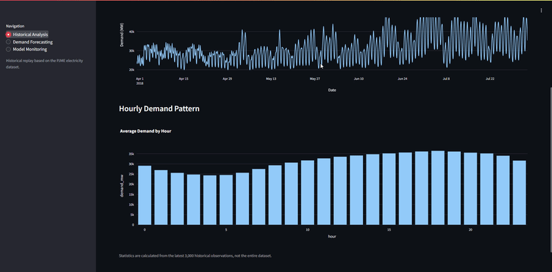

# EnergyFlow Analytics Platform

**An End-to-End Electricity Demand Forecasting & MLOps Platform Built on Databricks**

EnergyFlow Analytics Platform is a machine learning project that forecasts hourly electricity demand using historical PJM energy consumption data. It combines automated data pipelines, deep learning, experiment tracking, model monitoring, and an interactive dashboard in a unified Databricks environment.

The platform uses **PyTorch LSTM** to predict the next 24 hours of electricity demand based on the previous 168 hours, while **MLflow** and **Evidently AI** support model tracking and monitoring.

## Application Demo



*Interactive Streamlit dashboard showing electricity demand analysis, 24-hour forecasts, and model monitoring.*

## Key Features

- **Automated Data Pipelines:** Databricks Lakeflow Jobs orchestrates ingestion, validation, cleaning, and feature engineering.
- **Electricity Demand Forecasting:** Predicts the next 24 hours using PyTorch LSTM trained on 168-hour historical sequences.
- **Model Comparison:** Evaluates daily-naive, weekly-naive, XGBoost, and LSTM forecasting approaches.
- **Experiment Tracking:** MLflow tracks training configurations, evaluation metrics, and model artifacts.
- **Model Monitoring:** Evidently AI analyzes demand and prediction drift, while forecast error metrics are tracked over time.
- **Interactive Dashboard:** Streamlit visualizes historical electricity demand, forecasts, and monitoring results.

## Technology Stack

| Component | Technologies |
|---|---|
| Cloud Platform | Databricks |
| Data Engineering | PySpark, Spark SQL, Delta Lake |
| Workflow Orchestration | Databricks Lakeflow Jobs |
| Machine Learning | PyTorch, XGBoost, scikit-learn |
| Experiment Tracking | MLflow |
| Model Monitoring | Evidently AI |
| Dashboard | Streamlit, Plotly |
| Application Hosting | Databricks Apps |
| Programming | Python, SQL |

## Architecture

```text
          PJM Electricity Dataset
                    |
                    v
        Databricks Lakeflow Jobs
                    |
                    v
          PySpark + Delta Lake
       (Ingestion & Feature Engineering)
                    |
                    v
            Model Training
       (Naive, XGBoost, LSTM)
                    |
                    v
                  MLflow
        (Experiments & Artifacts)
                    |
                    v
           Batch Forecasting
         (Historical Replay)
                    |
                    v
          Delta Predictions Table
                    |
          +---------+---------+
          |                   |
          v                   v
      Evidently           Streamlit
    (Monitoring)         (Dashboard)
          |                   ^
          +---- Delta --------+
              Reports
```

The application runs entirely on Databricks, without requiring local Docker containers or a separate model-serving API.

## Dataset

**Source:** [PJM Hourly Energy Consumption — Kaggle](https://www.kaggle.com/datasets/robikscube/hourly-energy-consumption)

The project uses the `PJME_hourly.csv` dataset, containing **145,366 hourly electricity-demand observations** from 2002 to 2018.

- **Target:** Electricity demand (MW)
- **Forecast horizon:** 24 hours
- **Input sequence:** Previous 168 hours
- **Data splitting:** Chronological training, validation, and testing

The preprocessing pipeline identifies missing timestamps and daylight-saving-time irregularities. Forecasting windows are constructed within continuous, unambiguous local-time segments to avoid crossing unresolved timestamp gaps.

## Model Performance

The models were evaluated using historical forecasting windows on the PJME dataset.

| Model | Validation MAE (MW) | Test MAE (MW) |
|---|---:|---:|
| Weekly Naive | 3,208.41 | 3,491.52 |
| Daily Naive | 2,257.98 | 2,228.75 |
| XGBoost | 1,693.63 | 1,818.46 |
| **LSTM** | **1,590.57** | **1,768.06** |

The LSTM achieved approximately **20.7% lower test MAE** than the daily-naive baseline and **2.8% lower test MAE** than XGBoost.

The LSTM's additional test metrics were:

- **RMSE:** 2,406.52 MW
- **sMAPE:** 5.52%

These results are based on historical backtesting, not live electricity-demand forecasting.

## Streamlit Dashboard

The application provides three main sections:

**1. Historical Analysis**

Explore historical electricity demand, hourly consumption patterns, and demand trends.

**2. Demand Forecasting**

Select a historical forecast origin and compare the model's 24-hour predictions with actual electricity demand.

**3. Model Monitoring**

Visualize forecast errors over time, including MAE, RMSE, and sMAPE, alongside Evidently drift reports.

## Project Structure

```text
energyflow-analytics-platform/
|
├── app/                  # Streamlit application
├── config/               # Central project configuration
├── notebooks/            # Exploration and job entry points
├── resources/            # Databricks workflow definitions
├── src/
│   └── energyflow/
│       ├── ingestion/     # PJM data ingestion
│       ├── processing/    # Validation, cleaning, features
│       ├── training/      # Baselines, XGBoost, LSTM
│       ├── inference/     # Model loading and predictions
│       └── monitoring/    # Evidently and performance metrics
├── tests/                # Unit tests
├── databricks.yml        # Databricks bundle configuration
├── pyproject.toml        # Python dependencies
└── README.md
```

The project follows a modular Python architecture, keeping reusable processing, training, inference, and monitoring logic separate from notebooks and dashboard code.

## Getting Started

The project is designed to run on Databricks.

1. Clone the repository into a Databricks Git folder.
2. Upload `PJME_hourly.csv` to a Unity Catalog volume.
3. Configure `config/project.yaml` with your catalog, schema, and source-file location.
4. Execute the data pipeline through Databricks Lakeflow Jobs.
5. Run the model training and batch inference entry points.
6. Generate monitoring reports and deploy the Streamlit application using Databricks Apps.

Databricks compute, SQL warehouse access, and Unity Catalog permissions must be configured for the relevant jobs and application.

## Future Improvements

- Incorporate historical weather forecasts as additional model inputs.
- Explore improved LSTM architectures and hyperparameter tuning.
- Automate incremental forecasting and monitoring.
- Extend forecasting to additional PJM regions.

## Acknowledgments

Electricity demand data is sourced from the [PJM Hourly Energy Consumption dataset](https://www.kaggle.com/datasets/robikscube/hourly-energy-consumption/data), published on Kaggle by Rob Mulla.

---

**EnergyFlow Analytics Platform** — Data Engineering · Time-Series Forecasting · MLOps · Databricks